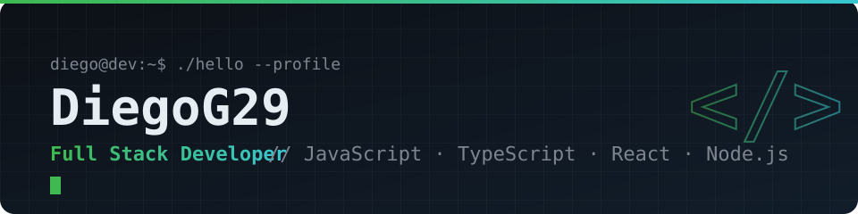
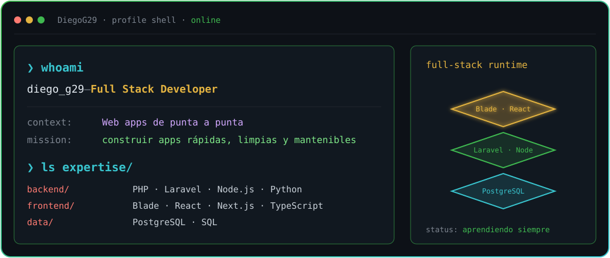

<a href="https://github.com/DiegoG29">
  <picture>
    <source media="(prefers-color-scheme: dark)" srcset="assets/banner-dark.svg">
    <source media="(prefers-color-scheme: light)" srcset="assets/banner-light.svg">
    
  </picture>
</a>

 

---

## `$ whoami`

  

 

## `$ cat tech-stack.yaml`

<table border="1" cellpadding="14">
  <thead>
    <tr>
      <th colspan="2" align="left"><code>diego@dev:~$ cat tech-stack.yaml</code></th>
    </tr>
  </thead>
  <tbody>
    <tr>
      <td width="50%" valign="top"><code>├─ ✦ languages:</code>  
         
        <code>PHP · JavaScript · TypeScript · Python · HTML · CSS</code>
      </td>
      <td width="50%" valign="top"><code>├─ ◧ frontend:</code>  
         
        <code>Blade · React · Next.js</code>
      </td>
    </tr>
    <tr>
      <td valign="top"><code>├─ ⚙ backend:</code>  
         
        <code>Laravel · Node.js · Python</code>
      </td>
      <td valign="top"><code>├─ ▣ database:</code>  
         
        <code>PostgreSQL</code>
      </td>
    </tr>
    <tr>
      <td colspan="2" valign="top"><code>╰─ ⌁ tools:</code>  
         
        <code>Git · GitHub · VS Code · Composer · npm</code>
      </td>
    </tr>
  </tbody>
  <tfoot>
    <tr>
      <td colspan="2"><code>status: building&nbsp;&nbsp;·&nbsp;&nbsp;environment: full-stack</code></td>
    </tr>
  </tfoot>
</table>

---

## `$ connect --socials`

 

Hecho con ☕ y código · @DiegoG29

